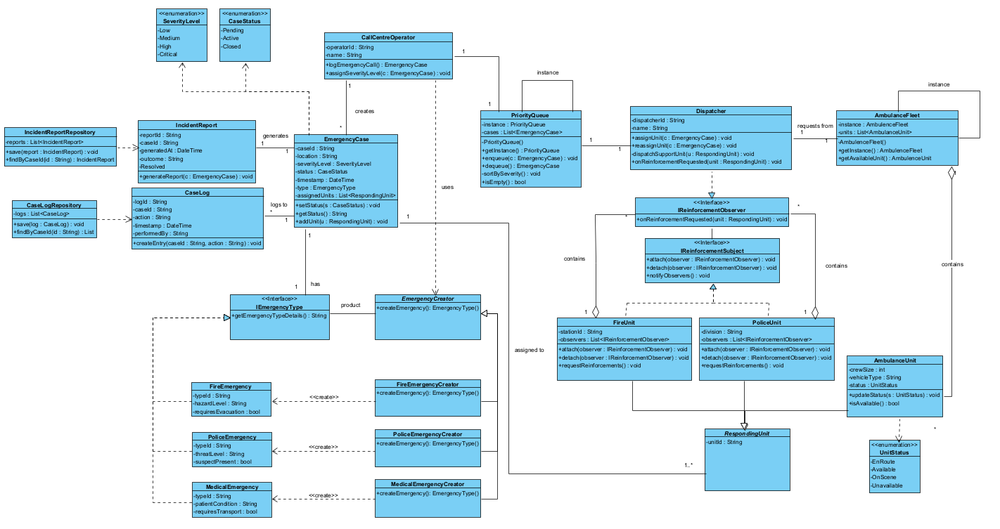
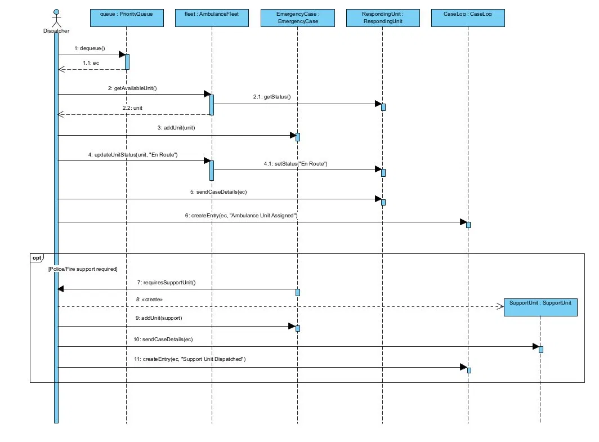
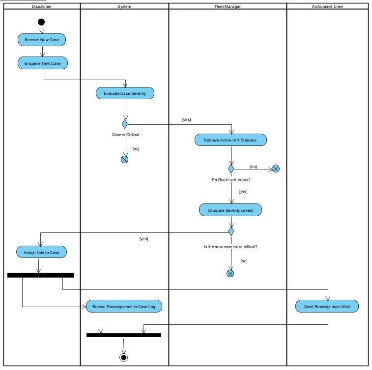

# Emergency dispatch modelling

A software architecture project for my software modelling course, taking a hypothetical emergency dispatch service from requirements and uml diagrams to a c# implementation.

The full process is documented in two reports: [requirements and initial design](St%20John%20Dispatch%20Modelling%20Report.pdf), followed by [architecture, implementation and reflection](St%20John%20Dispatch%20Modelling%20Report%202.pdf).

## Architecture and design

I defined stakeholder roles, system boundaries and functional and nonfunctional requirements, then linked them through a traceability table. Use case, class, sequence and activity diagrams helped me work through the structure and behaviour before refining the implementation.

The design separates call handling, dispatch, fleet management and reporting. I used abstraction, interfaces and enums to clarify responsibilities, and evaluated cohesion, coupling, single responsibility, open/closed and dependency inversion as the design changed.

<br>

<p align="center">
  <a href="docs/images/class-diagram.png"></a>
  <br>
  <em>Class diagram showing the architecture and design patterns</em>
</p>

<div align="center">
<table>
  <thead>
    <tr><th>Design pattern</th><th>Purpose</th></tr>
  </thead>
  <tbody>
    <tr><td>Singleton</td><td>Share one priority queue and fleet manager.</td></tr>
    <tr><td>Factory method</td><td>Create emergency types without tying call handling to concrete classes.</td></tr>
    <tr><td>Observer</td><td>Notify the dispatcher when support units request reinforcements.</td></tr>
  </tbody>
</table>
</div>

<br>

I evaluated whether each pattern made the code easier to extend and maintain, and where it added complexity or made testing and debugging harder.

I used sequence diagrams to show how objects interact during dispatch, and activity diagrams to map the decisions and responsibilities involved in reassigning a unit.

<br>

<p align="center">
  <a href="docs/images/dispatch-sequence.png"></a>
  &nbsp;&nbsp;
  <a href="docs/images/reassignment-activity.png"></a>
</p>
<p align="center"><em>Unit assignment sequence (left) and dynamic reassignment activity (right).</em></p>

<br>

## Running the demo

With the .NET 8 SDK installed:

```bash
dotnet run --project EmergencyDispatchSystem
```

The console demo implements the design patterns, not the full proposed system.

Editable Visual Paradigm models are included as `.vpp` files.
